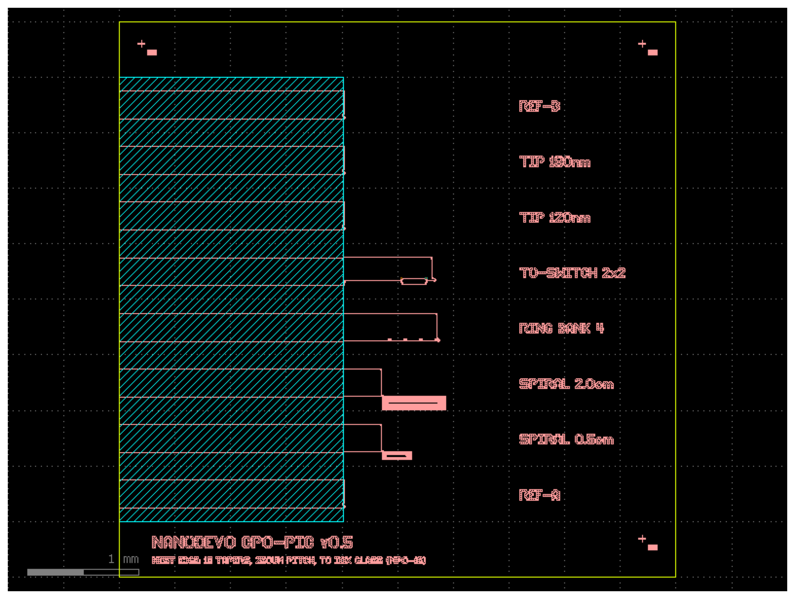
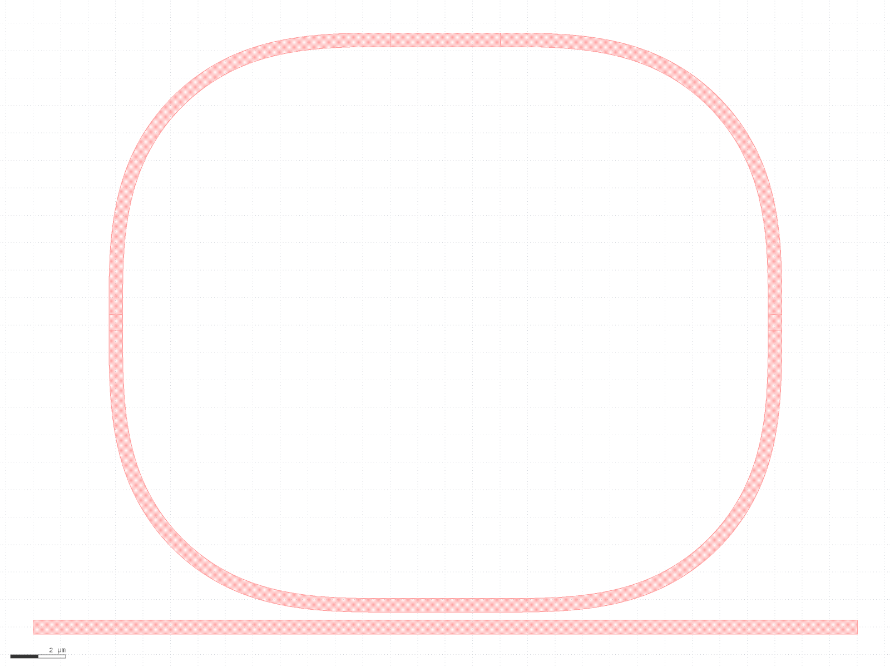
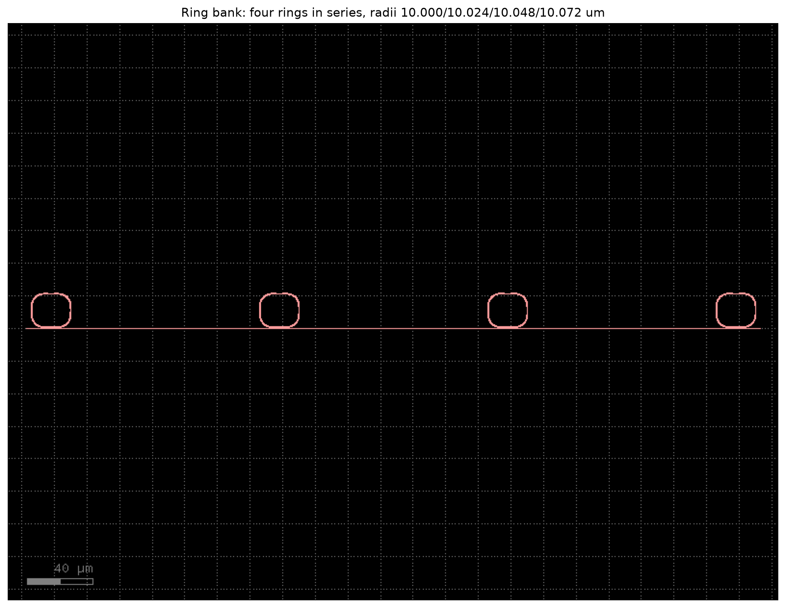
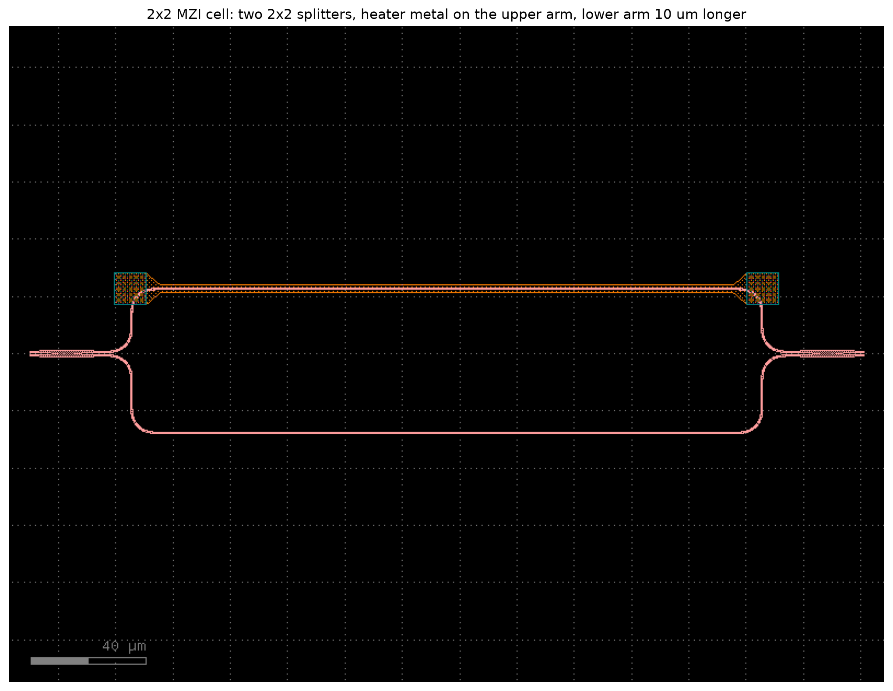
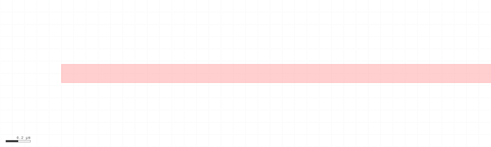
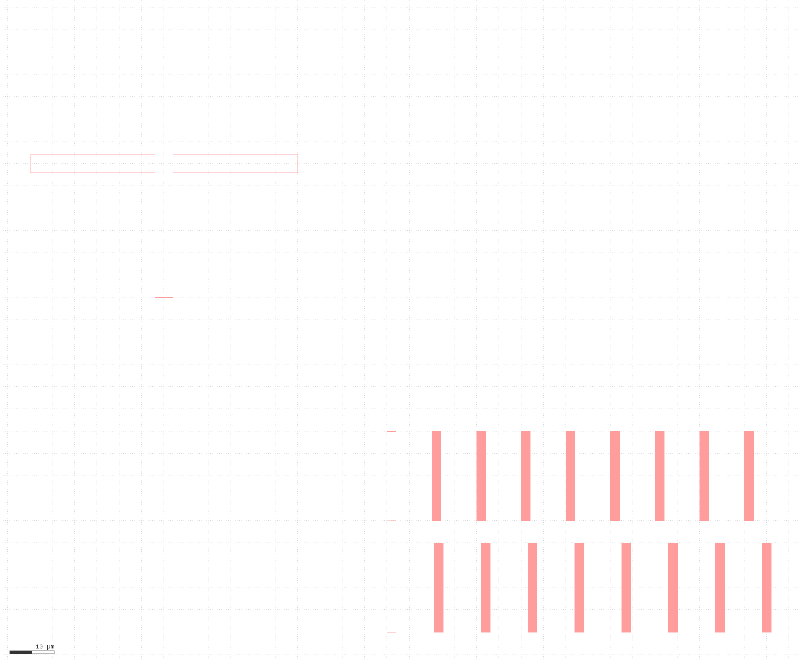
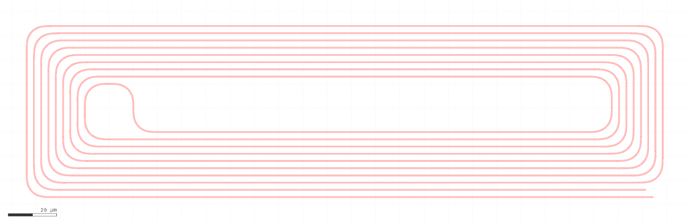
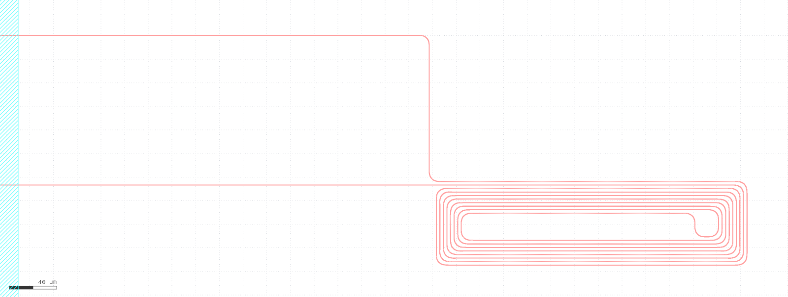

# cpo-pic

A passive photonic test die for glass-substrate co-packaged optics,
designed as the chip-side counterpart of my end-to-end connectivity
study ([nanodevo.github.io/reports/optical-connectivity](https://nanodevo.github.io/reports/optical-connectivity.html)).

The interface it is built to mate with is the published glass-substrate
architecture (Brusberg et al., *Glass Substrate for Co-Packaged Optics*,
IMAPS 2022; OFC 2020/2022/2025/2026): fibers enter an MPO connector
butt-coupled at the polished edge of an ion-exchanged (IOX) glass
waveguide substrate, the glass fans them into a single row at the die's
pitch, and the photonic die sits face-down on that glass,
coupling evanescently through a ~1 um adhesive bondline.

**[Rotate the full assembly in interactive 3D](https://nanodevo.github.io/reports/cpo-3d.html)** -
fibers, MPO-16 connector, IOX glass substrate, this PIC, and the switch ASIC.



## Interface contract

| Parameter | Value | Why |
|---|---|---|
| Coupler channels | 24 @ 127 um pitch, west edge | 127 um is the fine pitch of current fiber arrays and V-groove blocks; the glass fans a two-row MPO-24 (250 um) into this one row |
| Coupler type | linear adiabatic taper, 2 mm, 500 nm -> 150 nm tip | the evanescent-transfer half of the glass-to-PIC joint |
| Cladding | opened over the 24 tapers, die edge to 2.01 mm (own layer 60/0) | the silicon must meet the ~1 um adhesive with no top oxide in between; the generic PDK has no layer for it |
| Topology | loopbacks (in, out), one three-port cell | a fiber array on the glass grades every interface in transmission |
| Die | 5 x 5 mm | same class as the SiN test chips in the IMAPS paper |
| Fiducials | cross + Vernier, 3 corners | read through a split optic at placement; Vernier resolves residual misalignment |

## Channel plan

| Channels | Structure | Extracts |
|---|---|---|
| 1-2 | REF-A, reference loopback, south edge of the array | baseline insertion loss |
| 3-4 | + 0.5 cm spiral | four-point cutback with REF-A: |
| 5-6 | + 1.0 cm spiral | propagation loss per cm, and whether |
| 7-8 | + 2.0 cm spiral | it grows linearly with length |
| 9-10 | 4-ring bank, radii staggered by 24 nm, 300 nm gap | four notch families about a quarter of the FSR apart; per-ring group index, Q, loss |
| 11 | DARK, a taper with no loop | launch into a neighbour, read what leaks across: the crosstalk floor of the glass interface |
| 12-13 | REF-M, reference loopback, centre of the array | with REF-A and REF-B: coupling across the array (a roll shows as loss at the edges) |
| 14-15 | 4-ring bank at the model's critical gap, 367 nm | deepest notches; compared directly with the 300 nm bank |
| 16-18 | MZI: 1x2 splitter in, 2x2 combiner out, arms 100 um apart | input 16, both outputs to 17 and 18; the two outputs are complementary, so their ratio reads the interference independently of coupling loss; heater metal drawn without pads |
| 19-20 | taper split, 120 nm tip | coupler DOE: |
| 21-22 | taper split, 180 nm tip | tip-width sensitivity |
| 23-24 | REF-B, reference loopback, north edge | uniformity statistic |

The die is deliberately half interface-qualification vehicle, half
optical-engine skeleton: the loopbacks, cutbacks and taper splits grade
the glass-to-PIC interface (what must be proven first), while the WDM
ring bank and the 2x2 thermo-optic switch cell are the passive optical
circuit of the transceiver engine that would sit beside a switch ASIC
in a co-packaged optics assembly. The active layers (Ge photodiodes,
junction modulators, drivers) belong to the EIC/foundry side; the
PIC-to-ASIC connection is electrical, through the bumps and RDL of the
glass substrate.

## Cell gallery

The die overview above is at 5 mm scale; the devices are micrometers.
What each cell actually looks like, rendered by KLayout with gdsfactory's
layer colours (`python figures.py` regenerates them; it calls KLayout in
batch mode through `klayout_images.py`):

**One ring of the bank** - a 10 um racetrack next to a bus waveguide,
300 nm apart. Light at the ring's resonant wavelengths couples across the gap,
circulates, and is removed from the bus: a wavelength filter with no
moving parts.



**The 4-ring banks** (channels 9-10 at a 300 nm gap, 14-15 at 367 nm) - four such rings in series with
radii staggered by 24 nm, so each one notches a different wavelength
comb, about a quarter of the 7.8 nm free spectral range from the next.
They are all-pass rings: they measure group index, coupling and loss,
and they do not hand a wavelength to a detector, which would need
add-drop rings with a second bus.



**The thermo-optic MZI** (channels 16-18) - a 1x2 splitter divides the
light into two arms, a 2x2 combiner brings them back together onto two
outputs; the orange metal on the upper arm is a resistive heater. On this
die the heater has no pads. The lower arm is 100 um longer, so the two
outputs trade light every ~5.9 nm of wavelength, about 16 times across a
100 nm laser sweep: the depth of those fringes reads the combiner's
balance, their spacing the group index. Both outputs come back to the
glass, so no port of the cell is a dead end. S-bends spread the outputs
from 1.25 um to 10 um apart before they are routed.



**The coupler tip** (the first 3 um of the 2 mm taper, drawn true to the
layout) - the waveguide ends at the die edge 150 nm wide and widens by less
than 1 nm over these 3 um; it reaches 500 nm only at 2 mm. That narrow end
forces the mode out of the silicon so it can transfer evanescently to the
IOX guide in the glass below.



**Corner fiducial** - the cross and Vernier combs a vision-based die
bonder reads through a split optic at placement; the Vernier resolves
residual misalignment to 0.5 um.



**Cutback spiral** - 0.5 cm of waveguide coiled into 263 x 72 um; together
with the 1 cm and 2 cm versions and the references, propagation loss per
cm falls out of a linear fit, and four points show whether it is linear.



## Run

```bash
python -m venv .venv && .venv/bin/pip install gdsfactory
.venv/bin/python chip.py     # writes build/cpo_pic.gds and build/cpo_pic.png (image rendered by KLayout)
```

The images need the KLayout desktop application (found at its default macOS
location, on PATH, or through the `KLAYOUT` environment variable).

After every build, run the layout check:

```bash
.venv/bin/python check_layout.py   # PASS/FAIL: overlaps, gaps under 150 nm, cells closer than 2 um
```

It flags any two separate shapes on the silicon layer that share area
(a waveguide routed across another one) or come closer than 150 nm
without touching (the smallest intended spacing on the die is the
300 nm ring-to-bus gap). A third rule flags shapes from two different
placed cells (a ring and a route, two routes) that come closer than 2 um:
light would couple between them. Designed couplers sit inside one cell
and are not affected. Port-to-port joins are allowed. It is a sanity
check, not a foundry DRC.

Layout is generated with [gdsfactory](https://gdsfactory.github.io/gdsfactory/)
on the generic 220 nm SOI strip-waveguide PDK. The design intent lives in
the cell parameters, not the process: retargeting to a foundry PDK is a
cross-section swap.

## Roadmap

- Mode solver (femwell) on the taper cross-sections: effective-index
  walk along the 2 mm taper, adiabaticity check
- FDTD (MEEP) on the tip region
- DRC against a public foundry rule deck (beyond the in-house `check_layout.py`)
- Retarget to a SiN platform (closer index match to IOX glass)

## Revision notes

- **v0.7 (2026-11-07).** 24 channels at 127 um pitch instead of 16 at
  250 um, on the same 5 x 5 mm die. With eight more channels nothing had
  to be dropped: a 1.0 cm spiral makes the cutback four-point, a second
  ring bank sits at the model's critical gap, a centre reference (REF-M)
  joins the two edge references, and a dark channel measures crosstalk.
  The MZI is now a 1x2 splitter with a 2x2 combiner whose two outputs
  both reach the glass (channels 16-18), so no port is a dead end, and
  its arms are 100 um apart instead of 10 um: about 16 fringes per
  100 nm sweep instead of fewer than two. gdsfactory's mixed-MMI MZI puts
  the arms on the combiner's wrong ports unless they are named (o3/o4);
  the layout check caught the overlap. The interactive 3D assembly still
  shows the 16-channel version.

- **v0.6 (2026-11-07).** Loop-backs routed directly. Up to v0.5 each
  loop-back put a 180-degree bend on the output and the router then
  turned the light round a second time. On the reference and tip-split
  channels that extra U-turn reached 10 um back into the cladding window
  behind the tapers; after the ring bank it ran 346 nm past ring 4, a
  second coupler on that ring nobody designed. The switch's terminators
  ran 0.75 um beside the neighbouring port for their whole length; its
  ports now fan out to 10 um first, and the cell sits with its input
  level with channel 9, so the feed runs straight (it used to jog 35 um
  sideways right after the window). `check_layout.py` missed all of this
  because nothing came under 150 nm; it now also flags shapes from
  different cells closer than 2 um. Found by reviewing the layout in
  KLayout.

- **v0.5 (2026-11-07).** Ring bank: radius step 50 nm -> 24 nm and gap
  200 -> 300 nm. With 50 nm, rings 1 and 3 (and 2 and 4) resonated within
  about 0.5 nm of each other, so the four families collapsed into two
  pairs; the course's circuit model had hidden this by holding the
  coupler bends at the 10 um radius. At 200 nm the rings were
  over-coupled fifteen-fold and their notches about 1 dB deep. MZI cell:
  the 10 um arm difference is now set by a named constant (the old
  `MZI_DL = 100` was never used) and the open ports end in tapers.
  New cladding-open window over the tapers. Gallery figures redrawn to
  the layout (the taper tip had been drawn about 37 times too steep).

- **v0.4 (2026-09-04).** The cutback spirals on channels 3-6 are now
  attached port-to-port. In v0.3 the feed waveguide was routed straight
  through the spiral arms (dozens of unintended crossings; the cutback
  channels would have been unusable). Found with `check_layout.py`,
  added in the same revision; the die now passes it.

  

- **v0.3 (2026-08-21).** First complete die.

## References

- L. Brusberg et al., "Glass Substrate for Co-Packaged Optics",
  IMAPS 2022, pp. 236-241
- L. Brusberg et al., "Integrated Glass Waveguide Substrate with Surface
  Coupled Photonic Chips for Massive Scaling of CPO", OFC 2026, Th3C.2
- Full reference list and the physics: the
  [connectivity study](https://nanodevo.github.io/reports/optical-connectivity.html)
